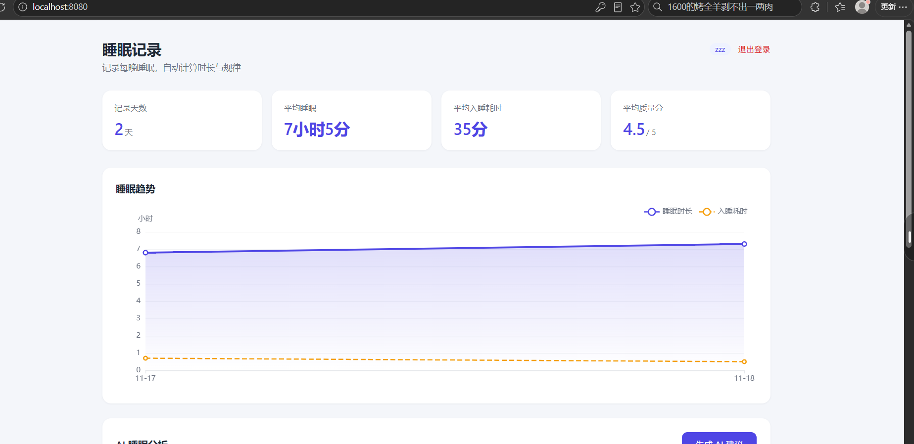

# 睡眠记录与 AI 分析平台

一个记录每日睡眠、自动统计并调用大模型给出个性化改善建议的全栈 Web 应用。



## 功能

- **睡眠记录**：记录上床、入睡、醒来时间，以及夜醒次数、主观质量评分
- **自动统计**：睡眠时长、入睡耗时（跨天自动修正）、平均质量分、最早/最晚入睡时间
- **趋势图**：ECharts 双折线图展示睡眠时长与入睡耗时变化
- **AI 分析**：把统计结果与最近 7 天记录拼成摘要，调用 DeepSeek 生成 3 条可执行建议
- **用户体系**：注册 / 登录，JWT 鉴权，每个用户只能访问自己的数据

## 技术栈

| 层次 | 技术 |
| --- | --- |
| 后端 | Java 17、Spring Boot 3.3、MyBatis-Plus 3.5 |
| 数据库 | MySQL 8 |
| 鉴权 | JWT（jjwt 0.12）、BCrypt 密码哈希 |
| AI | DeepSeek Chat API（OpenAI 兼容格式） |
| 前端 | Vue 3 + ECharts 5（CDN 引入，无需 Node 构建） |

## 项目结构

```
src/main/java/com/zyh/sleep
├── config/          # Web 配置、全局异常处理
├── context/         # 当前登录用户上下文（ThreadLocal）
├── controller/      # 接口层
├── dto/             # 数据传输对象
├── entity/          # 数据库实体
├── interceptor/     # JWT 登录拦截器
├── mapper/          # MyBatis-Plus Mapper
├── service/         # 业务逻辑（含 AI 调用）
└── util/            # JWT 工具类
src/main/resources
├── static/index.html    # 单文件前端页面
├── application.yml      # 公共配置（不含密钥）
├── application-local.yml# 本机私密配置（已 gitignore）
├── schema.sql           # 建库建表脚本
└── schema-user.sql      # 用户表脚本（启动时自动执行）
```

## 快速开始

### 1. 环境要求

- JDK 17+
- Maven 3.8+
- MySQL 8+

### 2. 初始化数据库

在 MySQL 中执行 `src/main/resources/schema.sql`，创建 `sleep_tracker` 库和 `sleep_record` 表。

`sys_user` 表由 `schema-user.sql` 在服务启动时自动创建，无需手动执行。

### 3. 本地配置

在 `src/main/resources/` 下新建 `application-local.yml`（该文件已被 `.gitignore` 忽略）：

```yaml
spring:
  datasource:
    password: "你的数据库密码"

ai:
  api-key: "你的 DeepSeek API Key"

jwt:
  secret: "自定义一个至少 32 位的随机字符串"
```

`application.yml` 中的 `spring.profiles.active: local` 会自动加载这个文件。

### 4. 启动

```bash
mvn spring-boot:run
```

或在 IDEA 中直接运行 `SleepTrackerApplication`。

浏览器访问 <http://localhost:8080>，注册账号后即可使用。

## 接口说明

除 `/api/auth/**` 外，所有接口都需要请求头 `Authorization: Bearer <token>`。

| 方法 | 路径 | 说明 |
| --- | --- | --- |
| POST | `/api/auth/register` | 注册并返回 token |
| POST | `/api/auth/login` | 登录并返回 token |
| GET | `/api/records` | 当前用户的全部睡眠记录 |
| POST | `/api/records` | 新增记录 |
| PUT | `/api/records/{id}` | 修改记录（校验归属） |
| DELETE | `/api/records/{id}` | 删除记录（校验归属） |
| GET | `/api/records/stats` | 统计汇总 |
| GET | `/api/records/advice` | AI 睡眠建议 |

## 设计说明

- **跨天时间计算**：入睡常在午夜之后，直接相减会得到负数，统一对负值加 24 小时修正。
- **数据隔离**：JWT 只携带 `userId`，拦截器验签后写入 ThreadLocal，所有查询都附带 `user_id` 条件；修改和删除前额外校验记录归属。
- **AI 调用策略**：不把原始数据表直接交给模型，而是先聚合成自然语言摘要，既降低 token 成本，也让建议更聚焦。
- **密钥管理**：真实密钥与数据库密码只存在于本地的 `application-local.yml`，仓库中的 `application.yml` 仅使用占位符。

## 后续规划

- 记录编辑与按周 / 月范围筛选
- AI 建议结果缓存，避免重复调用
- Docker 部署
